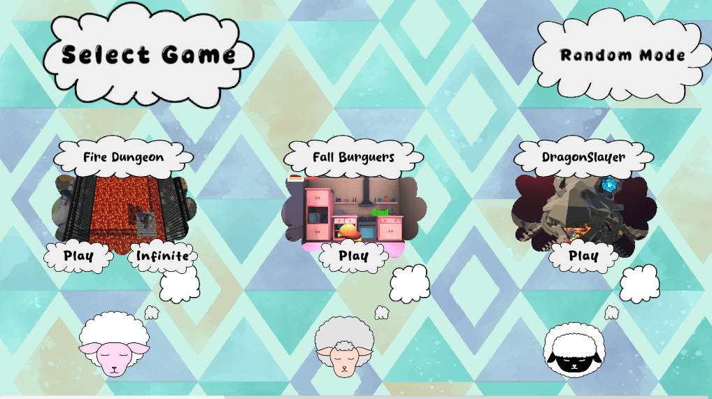
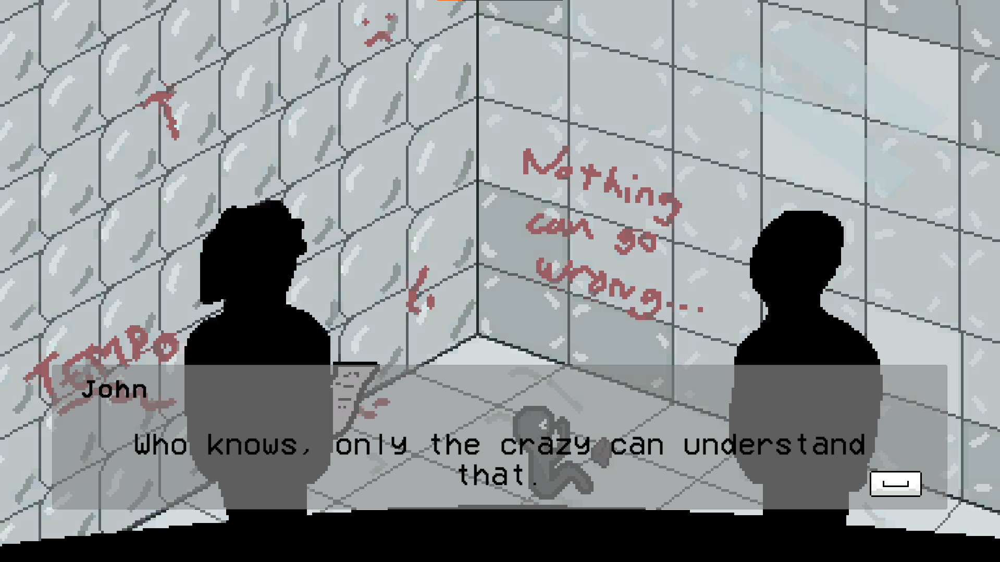
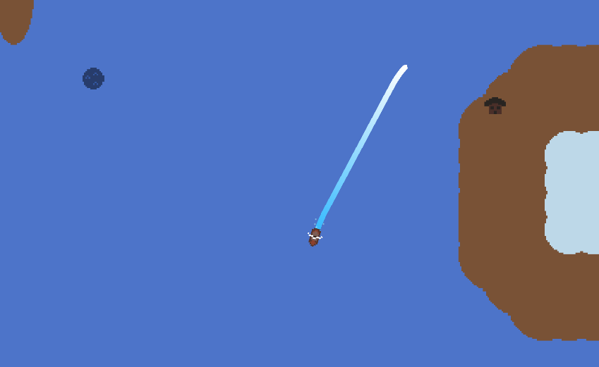
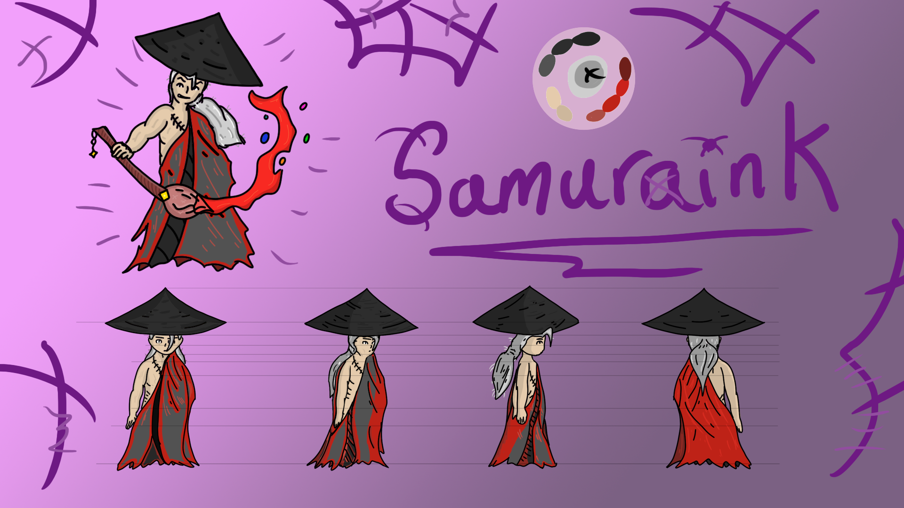
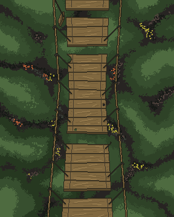

# 👋 ¡Hola! Soy Juan Manuel, creador indie en VoidWatcherGames, mi propio estudio.

🎮 Desarrollador de videojuegos indie, trabajando en mi primer proyecto grande.  
🔧 Trabajo con Unity, aunque también conozco Godot.       
👔 Estudiante de Desarrollo Web, con el título de Desarrollador de Aplicaciones Multiplataforma.         
🧭 Aún no tengo portfolio web, pero tengo varias ideas para reemplazar este portfolio temporal en el futuro.

---

## 🕹️ Proyectos Destacados 
(La mayoría se pueden jugar en el navegador gracias a webgl)

### [🔗 Treasure Trenches](https://juanmasg.itch.io/treasure-trenches)
*Un juego de buceo con mejoras, logros y más, ¿podrás llegar al fondo?*
**Juego de GameJam realizado en 1 semana**
**Rol:** Desarrollo del código, los assets artísticos y el diseño. La música fue sacada de internet con licencia.
**Herramientas**: Unity y Aseprite

### [🔗 Solstice Lighthouse](https://juanmasg.itch.io/treasure-trenches)
*Un juego de gestión de una aldea, se hizo lo que se pudo con el poco tiempo*
**Juego de GameJam realizado en 4 días**
**Rol:** Desarrollo del código, los assets artísticos y el diseño.
**Herramientas**: Unity y Photoshop

### [🔗 Lone Watcher](https://juanmasg.itch.io/lone-watcher)
*Un juego donde tendrás varias tareas diarias, estando solo en mitad del espacio, prototipo técnico*
**Juego de GameJam realizado en 7 días**
**Rol:** Desarrollo del código. La música fue compuesta por un compañero de jam.
**Herramientas**: Unity
 
### [🔗 Dream Party](https://dokozak.itch.io/ficzone-2025)
*Una compilación de minijuegos con diferentes jugabilidades.*  
*Este juego fue creado en grupo con varios compañeros de clase para el evento Ficzone, donde presentamos el juego.*            
**Rol:** Crear varios minijuegos, y algunos menus.
**Herramientas:** Unity y Blender  

### [🔗 Tempo Keeper](https://juanmasg.itch.io/tempo-keeper)
*Un corto juego donde hay que mantener un ritmo constante mientras minijuegos intentan distraerte.*  
**Juego de GameJam realizado en 1 semana**
**Rol:** Todo, el juego lo realicé yo en su totalidad.
**Herramientas:** Unity y Aseprite

Tengo otros prototipos como:                     
[Daily Prelude](https://juanmasg.itch.io/daily-prelude)
[Keybound Souls](https://juanmasg.itch.io/keybound-souls)
---

## 📂 Tecnologías y herramientas de GameDev

- Unity (nivel intermedio)
- Godot
- C#
- Git & GitHub
- Aseprite, Blender, Photoshop

## 📂 Tecnologías y herramientas de Desarrollo Web y DAM

- PHP
- JavaScript, NodeJS
- HTML, CSS
- Flutter, Firebase, Kotlin
- Python

---

## 📫 Contacto

- 📧 **Email:** juanmasg55@email.com  
- 💼 [LinkedIn](https://linkedin.com/in/juanma-salinas-gonzález)  
- 🐙 [GitHub](https://github.com/juanmasg-dev)  
- 🎮 [Itch.io](https://juanmasg.itch.io)

---

> *“Los videojuegos son la mejor forma de experimentar la creatividad de otra persona”*

---
### Aquí va un pequeño portfolio de arte:
*Dream Party*  
  
*Tempo Keeper*  
  
*Ocean's Gloom*  
  
*Una guía de estilos de un personaje creado en clase*  
  
*Una prueba de pixelart*  
  
